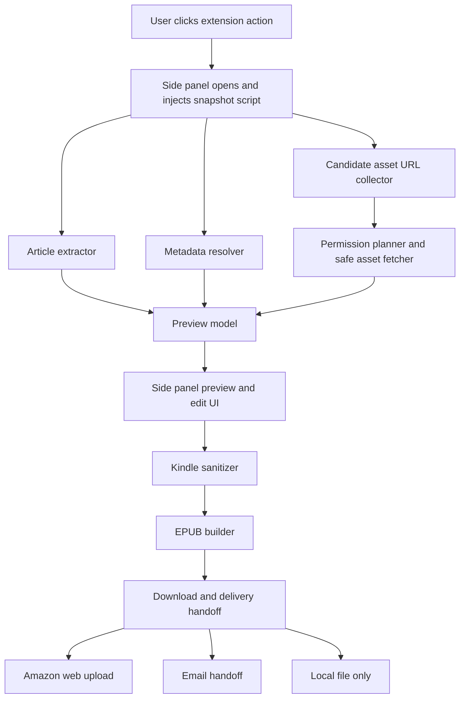
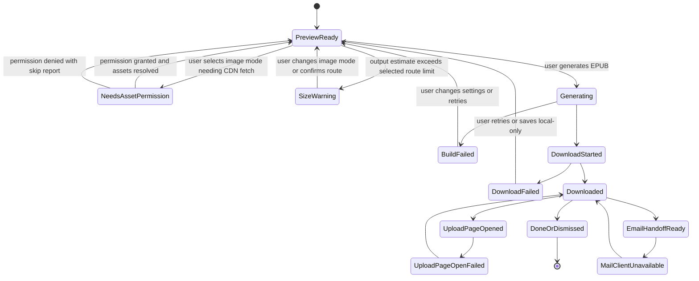

# feat: Build a Kindle-ready article EPUB extension

## Summary

Build a public, open-source Chrome extension that turns the current article page into a Kindle-ready EPUB with a trustworthy preview, editable metadata, image-aware output, and delivery handoff through Amazon-supported paths. The MVP is a Kindle-ready article converter with official-route handoff, not a full replacement for Amazon's account-integrated extension. It should make the Wolfram and FS.blog examples first-class compatibility targets while avoiding Amazon login automation, private Amazon endpoints, Amazon branding, or reuse of Amazon's proprietary extension assets or code.

---

## Problem Frame

Amazon's official "Send to Kindle for Google Chrome" extension still presents the right product shape - quick send, preview, selection send, editable title/author, and device/library targeting - but its public listing shows version `2.1.1.7`, updated January 2024, with a 3.2 rating, 1.1K ratings, and 500K users. The listing itself says the extension may not work on sites that prevent extension use or when JavaScript-blocking extensions interfere. Mirrored recent reviews cluster around sign-in loops, failed previews/uploads, broken buttons, and missing pictures.

The two target articles expose the failure modes this project needs to handle. The Wolfram article has strong citation metadata for Stephen Wolfram and the 2023-02-02 publication date, but it is a long, image-heavy WordPress page with roughly 195 image tags, most hosted on `content.wolfram.com`. The FS.blog page has rich JSON-LD and Open Graph metadata, but the reader-visible authorship is nuanced: the page title says "by Charlie Munger" while site metadata also names Farnam Street and Shane Parrish. A better extension should not leave author blank; it should rank candidates and let the user correct them in preview.

Amazon currently documents official Send to Kindle routes through web upload, authorized email address, Kindle mobile apps, desktop apps, and the Chrome extension. Amazon's web upload supports documents up to 200 MB, while email troubleshooting documents a 50 MB attachment limit, 25 document count limit, approved sender requirements, throttling, and web extraction errors for empty, protected, or incompatible web pages. This project should generate clean files that fit those documented routes instead of pretending there is a stable public Amazon article-upload API.

The adoption thesis is deliberately narrow for the first usable version: users who are frustrated by failed previews, blank metadata, missing images, or sign-in loops may accept one manual upload step if the extension produces a visibly better Kindle-ready file with clear size/image diagnostics. "Better" for MVP means higher conversion reliability, better metadata, representative images, and a file that Amazon accepts through documented routes, not fewer clicks than Amazon's official extension.

---

## Requirements

### Article Capture and Preview

- R1. The extension captures the active page on explicit user action and produces a readable article preview without requiring an Amazon login.
- R2. The preview preserves enough structure for long-form reading: headings, paragraphs, lists, links, code/preformatted blocks where present, footnotes/endnotes when detectable, and captions or alt text for meaningful images.
- R3. The preview exposes a conversion report before download or handoff, including included images, skipped images, estimated output size, extraction warnings, and delivery-limit warnings. The report has blocking, warning, notice, and diagnostic severities, with a clear user action for each blocking or warning item.
- R4. The extension handles selection-only send as a separate mode when the user has selected text on the page.

### Metadata Quality

- R5. The metadata resolver pre-fills title, author, source, canonical URL, publication date, and language from a ranked combination of JSON-LD, citation metadata, Open Graph, Twitter cards, DOM bylines, visible article text, and URL/site fallbacks.
- R6. The Wolfram target should pre-fill Stephen Wolfram as author and February 2, 2023 as publication date from citation and visible metadata.
- R7. The FS.blog target should not leave author blank; it should surface a high-confidence reader-facing candidate from the page title/content and lower-confidence publisher/source candidates separately.
- R8. Users can edit title, author, date, and source before generating the final file, and those edits are persisted only as local user settings/history needed for the feature. Storage must avoid article bodies and full reading-history URLs, cap retained recent items, avoid `chrome.storage.sync` in MVP, and provide clear/delete controls.

### Kindle-Compatible Output

- R9. EPUB is the canonical output format for generated articles because Amazon's Send to Kindle service supports EPUB and it carries metadata, chapters, images, and reflowable text more predictably than raw web HTML.
- R10. The generator removes or transforms elements Amazon documents as conversion risks where practical: scripts, forms, audio/video, SVG-only images, oversized tables, problematic nested footnotes, and decorative assets.
- R11. Image inclusion is size-aware and user-controlled. MVP modes are text-only, cover-only, and capped smart images, each with an explicit estimated size and a warning when web or email limits are likely to be exceeded. Full-images mode is deferred until target-page Kindle acceptance proves the capped modes work.
- R12. The extension records image provenance and skip reasons, such as CORS/permission failure, unsupported type, fetch timeout, size budget, duplicate asset, or decorative classification.

### Delivery and Compliance

- R13. MVP delivery uses user-mediated official routes: download the generated EPUB, open Amazon Send to Kindle for web upload, and optionally prepare an email handoff with recipient and subject/body metadata for the user's mail client workflow.
- R14. The extension must not automate Amazon login, scrape Amazon account pages, store Amazon credentials, access Amazon cookies, or call private Amazon delivery endpoints.
- R15. Any future automatic delivery connector must be explicitly opt-in, documented, and implemented only through a user-authorized email transport or a newly discovered official API.
- R16. Chrome permissions must be minimal at install time, with active-page capture performed through toolbar-action-triggered programmatic injection. Broader host access for image bytes must be declared as optional host permission, requested from an explicit user gesture, scoped to discovered asset origins, and removed after conversion unless the user chooses to remember it.
- R17. The Chrome Web Store listing, privacy policy, permissions justification, screenshots, GitHub README, and license must be ready before public submission, but public submission is a release milestone after MVP Kindle acceptance, not the first development milestone.
- R18. Public identity must avoid Amazon impersonation: no Amazon or Kindle marks in the product name, icon, package ID, or store title; only nominative/descriptive compatibility wording where needed; and explicit "not affiliated with Amazon" language in public docs and listing copy.

### Compatibility Study

- R19. The repository includes a public research note describing the official extension's user-visible behavior, public failure signals, and why this project avoids reverse-engineering or code reuse.
- R20. The test suite includes representative fixtures for the Wolfram and FS.blog article shapes without committing full copyrighted article bodies.
- R21. The first release includes a manual acceptance matrix for the Wolfram and FS.blog URLs, plus at least two ordinary article fixtures and one difficult image/CORS fixture.

---

## Key Technical Decisions

- KTD1. WXT plus TypeScript for the extension scaffold: WXT supports MV3, file-based entrypoints, generated manifests, TypeScript, dev reload, zipping, and publishing helpers, which reduces greenfield browser-extension plumbing while staying close to Chrome's platform model.
- KTD2. Local-first conversion with no backend in the MVP: article HTML, metadata, images, and EPUB output are processed in the browser extension. This keeps privacy posture simple and avoids transmitting website content to a service the user did not explicitly ask for.
- KTD3. Use `@mozilla/readability` as the primary article extraction engine, with project-specific metadata and asset layers around it: Readability is proven for article body extraction and returns title, byline, site name, language, excerpt, published time, and content, but the Wolfram and FS.blog cases need richer metadata ranking and image handling than Readability alone.
- KTD4. EPUB is the canonical deliverable. Amazon supports HTML and EPUB, but EPUB gives the extension a controlled package with metadata, images, stylesheet, and table of contents. Debug HTML export is deferred from MVP unless it is added as an explicit local-only troubleshooting export with its own UI, privacy boundary, and tests.
- KTD5. User-mediated Amazon delivery first: the extension downloads a clean file and opens Amazon's supported upload surface or email workflow. Direct one-click send is deferred because current public research did not identify a documented Amazon app API for third-party browser extensions, Chrome cannot safely pre-fill a third-party file picker with a local generated file, Amazon email delivery has approved-sender and throttle constraints, and Chrome Web Store policy makes hidden credential/cookie handling a bad fit.
- KTD6. Optional host permissions for asset fetching: install-time permissions should stay narrow, using `activeTab`, `storage`, `downloads`, `sidePanel`, and `scripting` as needed. Runtime-discovered image hosts require `optional_host_permissions`, a visible user gesture such as "Grant image access," and a default lifecycle that removes the optional host permission after the active conversion unless the user chooses to remember it.
- KTD7. Image budgeting is part of conversion, not a post-processing afterthought: the Wolfram target's image count makes "include everything" potentially incompatible with email limits and possibly web upload limits. MVP should prove cover-only and capped smart-images first, with quantitative image-retention and size targets. Full-images, advanced decorative classification, and aggressive resize/compress tuning are follow-up hardening work.
- KTD8. Public compatibility study, not reverse engineering: use Amazon's public listing, public reviews, official help pages, and black-box user-visible behavior as inputs. Do not inspect, copy, reuse, or mimic Amazon's proprietary extension internals, branding, icons, or private endpoint behavior.
- KTD9. MV3 execution contexts stay explicit: the toolbar action opens the side panel and programmatically injects snapshot code into the active tab via `chrome.scripting.executeScript`. Content-page code only collects the document/selection and candidate asset URLs. Asset bytes, EPUB generation, Blob/Object URL creation, and downloads run from the visible extension side panel; the background service worker coordinates actions and tabs rather than owning long-running conversion work.
- KTD10. No telemetry in MVP: no analytics, remote crash reporting, automatic diagnostic upload, or backend logging. Conversion reports stay local and avoid article excerpts, full URLs with query strings/fragments, and content-bearing diagnostics unless the user explicitly exports a local file.

---

## Milestones and Release Gates

### M1. Usable Unpacked MVP

Build the smallest vertical slice that can be loaded unpacked in Chrome: toolbar action, side panel, active-page snapshot, Readability extraction, basic metadata ranking/editing, capped EPUB generation, download, and Amazon web/email handoff copy. This milestone intentionally defers store screenshots, broad compatibility docs, debug HTML, full-images mode, and advanced image transforms until the Wolfram and FS.blog paths produce Kindle-readable files.

**Gate:** At least one ordinary fixture and one target-shape fixture produce an EPUB that passes EPUBCheck, downloads locally, and opens in a local reader with correct title/author metadata.

### M2. Target-Page Kindle Acceptance

Harden images, route-fit warnings, metadata alternatives, and delivery handoff against the real Wolfram and FS.blog URLs plus the representative fixtures. This milestone proves the product is meaningfully better than a bookmarklet or manual save flow.

**Gate:** Wolfram, FS.blog, one ordinary live article, and one difficult image/CORS fixture are manually uploaded through Amazon web or delivered through approved-sender email and opened in a Kindle app/device with correct title, author, reading flow, table of contents when applicable, and representative images.

### M3. Public Repository and Chrome Store Release

Prepare the public repo, store listing, privacy disclosures, support path, screenshots, release zip, and unlisted/draft Chrome Web Store submission. This is where naming, trademark, permission justifications, and review timing become blocking release criteria.

**Gate:** Public identity is non-Amazon, permission and data-use disclosures match the generated manifest and implementation, no copyrighted article bodies or excessive review excerpts are committed, and the extension package is reproducible from documented commands.

---

## High-Level Technical Design

### Conversion Pipeline



Content-page code must not fetch arbitrary URLs or act as a privileged proxy. It collects the current document/selection and candidate asset URLs from the active page. The extension-side asset layer validates candidates against the snapshot, allowed schemes, user-granted origins, MIME type, size caps, and route budget before reading bytes.

### Delivery State Machine



Delivery states should map to UI actions:

| State | Primary action | Recovery / responsibility |
| --- | --- | --- |
| `Generating` | Disable duplicate generation and show progress | User can cancel only if implementation can safely abort |
| `BuildFailed` | Show builder error category | User can change image mode, fix metadata, or retry |
| `DownloadStarted` | Save EPUB with clean filename | Extension revokes temporary Blob URLs after completion/failure |
| `DownloadFailed` | Retry download | User can choose a different browser download location if Chrome prompts |
| `Downloaded` | Show file name/location and next route | User manually uploads/sends the file |
| `UploadPageOpened` | Open official Amazon upload URL | User selects the downloaded EPUB; extension does not automate login or file picker |
| `UploadPageOpenFailed` | Copy/open upload URL again | User can continue with local file or email handoff |
| `EmailHandoffReady` | Show Kindle email, subject/body guidance | User sends from an approved address and attaches the downloaded EPUB |
| `MailClientUnavailable` | Copy email details | User completes sending manually |
| `DoneOrDismissed` | Close or reset | Extension retains only allowed local settings/history |

---

## Output Structure

The implementation may adjust details, but the planned repository shape is:

```text
.
├── README.md
├── LICENSE
├── package.json
├── tsconfig.json
├── wxt.config.ts
├── vitest.config.ts
├── playwright.config.ts
├── entrypoints/
│   ├── background.ts
│   └── sidepanel/
│       ├── index.html
│       └── App.tsx
├── public/
│   ├── icon-16.png
│   ├── icon-48.png
│   └── icon-128.png
├── src/
│   ├── diagnostics/
│   ├── delivery/
│   ├── ebook/
│   ├── extraction/
│   ├── storage/
│   └── ui/
├── tests/
│   ├── delivery/
│   ├── ebook/
│   ├── e2e/
│   ├── extraction/
│   ├── fixtures/
│   ├── manifest/
│   └── ui/
└── docs/
    ├── privacy.md
    ├── research/
    │   └── official-send-to-kindle.md
    └── store-listing.md
```

---

## Implementation Units

### U1. Project Scaffold and Chrome Store Baseline

**Goal:** Establish the greenfield extension project with WXT, TypeScript, test harnesses, CI, manifest policy tests, minimal side-panel/action wiring, public identity rules, license, privacy document, and Chrome Web Store preflight draft.

**Requirements:** R13, R16, R17, R18

**Dependencies:** None

**Files:**

- `package.json`
- `tsconfig.json`
- `wxt.config.ts`
- `vitest.config.ts`
- `playwright.config.ts`
- `.github/workflows/ci.yml`
- `entrypoints/background.ts`
- `README.md`
- `LICENSE`
- `SECURITY.md`
- `docs/privacy.md`
- `docs/store-listing.md`
- `tests/manifest/permissions.test.ts`

**Approach:** Scaffold WXT as a Chrome MV3 extension, pin TypeScript and test tooling, and define the initial manifest around the minimal permission set: `activeTab`, `scripting`, `sidePanel`, `storage`, and `downloads`, with required `host_permissions` empty. Declare runtime-discovered image access through `optional_host_permissions` rather than install-time host access. Add minimal `entrypoints/background.ts` action/side-panel orchestration here so later UI work can open reliably, but keep conversion and generated-file work out of the background service worker.

Document the single purpose as "convert the current article into a Kindle-ready document" and make the privacy posture explicit: local processing by default, no Amazon credentials, no analytics, no remote crash reporting, no automatic diagnostic upload, and no sale or unrelated transfer of page content. Public identity work is blocking before publication: choose a non-Amazon name, icon, package ID, README headline, and store title; use "Send to Kindle" only as descriptive route language; and include clear "not affiliated with Amazon" language.

**Patterns to follow:** Chrome's MV3 requirements for service workers and packaged code; Chrome Web Store policies for single purpose, minimum permissions, privacy policy, secure handling, accurate listing metadata, and non-obfuscated code.

**Test scenarios:**

- Manifest permissions test verifies the generated Chrome manifest does not request cookies, history, webRequest, static `<all_urls>` content scripts, or all-host permissions at install time.
- Manifest permissions test verifies required MV3 fields, action/side panel entrypoints, icons, version, and privacy-relevant permissions are present.
- Manifest permissions test verifies required `host_permissions` is empty and runtime image access is represented only as optional host permissions.
- CI packaging test verifies a production extension bundle can be produced and contains no remotely hosted scripts.
- Bundle/config check verifies no analytics, remote crash reporting, or remote diagnostic upload package/endpoint is present in MVP.

**Verification:** A reviewer can load the unpacked extension, inspect the generated manifest, read the draft privacy/store listing docs, and see CI covering manifest policy assumptions.

### U2. Page Snapshot and Readability Extraction

**Goal:** Capture the active tab's article or current selection and produce normalized article content for preview.

**Requirements:** R1, R2, R4, R20, R21

**Dependencies:** U1

**Files:**

- `src/extraction/injectedSnapshot.ts`
- `src/extraction/documentSnapshot.ts`
- `src/extraction/selectionSnapshot.ts`
- `src/extraction/readabilityAdapter.ts`
- `src/extraction/contentNormalizer.ts`
- `tests/extraction/readabilityAdapter.test.ts`
- `tests/extraction/contentNormalizer.test.ts`
- `tests/fixtures/articles/wolfram-shape.html`
- `tests/fixtures/articles/fsblog-shape.html`
- `tests/fixtures/articles/ordinary-news-shape.html`
- `tests/fixtures/articles/ordinary-blog-shape.html`

**Approach:** Use toolbar-action-triggered programmatic injection via `chrome.scripting.executeScript` and `activeTab` to run a bundled snapshot function in the current tab. The injected code clones the current document or selection into a serializable snapshot, collects candidate image URLs and nearby captions, strips unsafe/runtime-only elements, and returns data to the side panel/background message path. It must not be a static broad content script and must not fetch privileged asset bytes.

Pass a DOM copy through Readability and normalize the resulting HTML into the subset the preview and EPUB builder can safely consume. Fixture files should be representative fragments, not full copied articles.

**Execution note:** Add characterization fixtures for the Wolfram and FS.blog shapes before tuning extraction behavior.

**Patterns to follow:** Readability's parse contract, Chrome content script messaging, and MV3's event-driven background model.

**Test scenarios:**

- Happy path: ordinary news and blog fixtures with title, body, headings, links, and paragraphs return readable content with the main article selected.
- Manifest path: snapshot code is injected programmatically after user action; generated manifest contains no static `<all_urls>` `content_scripts`.
- Wolfram shape: a fixture with citation metadata, large article body, magnified image anchors, lazy image attributes, and script-heavy header still extracts the article body.
- FS.blog shape: a fixture with JSON-LD, WordPress wrapper markup, and long transcript content extracts article content without navigation, footer, newsletter, or search UI.
- Selection mode: selected text produces a selection document and bypasses unrelated page content.
- Error path: pages with no readable article return a structured extraction failure that the UI can display instead of silently producing an empty EPUB.

**Verification:** Extraction returns deterministic preview models for representative fixtures, and the extension reports a clear error when article content is unavailable.

### U3. Metadata Resolver and Editable Candidate Ranking

**Goal:** Produce confidence-ranked metadata candidates, expose enough state for preview editing, and persist only safe local correction rules.

**Requirements:** R5, R6, R7, R8, R20, R21

**Dependencies:** U2

**Files:**

- `src/extraction/metadataResolver.ts`
- `src/extraction/metadataSources.ts`
- `src/extraction/authorCandidates.ts`
- `src/extraction/dateCandidates.ts`
- `src/storage/recentMetadataEdits.ts`
- `tests/extraction/metadataResolver.test.ts`
- `tests/extraction/authorCandidates.test.ts`
- `tests/extraction/dateCandidates.test.ts`
- `tests/fixtures/articles/wolfram-metadata.html`
- `tests/fixtures/articles/fsblog-metadata.html`

**Approach:** Build a resolver that gathers JSON-LD, citation tags, Open Graph, Twitter cards, Readability output, visible byline/title patterns, and site fallbacks into candidate lists. Rank by source reliability and page context, surface one pre-fill plus alternatives, and persist only explicit user corrections useful for future same-site conversions. Preview field editing itself belongs to U6; U3 produces the candidate model, confidence labels, conflict warnings, and local persistence API consumed by the UI.

Metadata editor states that U3 must support:

| State | Meaning | Required behavior |
| --- | --- | --- |
| Prefilled | One high-confidence candidate exists | UI can show the field as ready and still expose alternatives |
| Low confidence | Only weak/fallback candidates exist | UI marks the field as review-needed rather than hallucinating |
| Conflict | Multiple credible sources disagree | UI can show alternatives and a warning |
| User edited | User changes field manually | EPUB generation uses edited value and marks state dirty |
| Selected alternative | User chooses another candidate | Candidate source is retained for report/debugging without storing article body |
| Persisted prior edit | Same-site correction exists | UI shows it as local history and lets user reset |
| Reset | User clears local choice | Field returns to resolver-ranked candidates |

Storage policy: use `chrome.storage.local` only in MVP, store per-site correction rules and user preferences rather than article bodies or full URLs, cap recent metadata history, and provide a clear/delete path.

**Execution note:** Implement this unit test-first because metadata regressions are easy to miss visually.

**Patterns to follow:** Readability metadata fields, Schema.org article/page conventions, WordPress/Yoast JSON-LD patterns, and citation metadata used by academic or author-owned sites.

**Test scenarios:**

- Wolfram fixture: `citation_author` and `citation_publication_date` outrank generic site metadata and pre-fill Stephen Wolfram and 2023-02-02.
- FS.blog fixture: visible/title candidate "Charlie Munger" is surfaced as the reader-facing author candidate, while Shane Parrish/Farnam Street remain available as publisher/source candidates rather than leaving author blank.
- JSON-LD article fixture: `author`, `publisher`, `datePublished`, and `dateModified` are parsed and ranked correctly.
- Conflicting metadata: citation and JSON-LD disagreements produce alternatives and a warning, not silent overwrite.
- Missing metadata: unknown author/date fields remain editable and are marked low confidence rather than hallucinated.
- Persistence: user edits for a site are saved locally and can be reused without transmitting browsing content externally.
- Metadata editor state: choosing an alternative, manually overriding a field, resetting persisted local history, and generating EPUB metadata from edited values are all covered by tests.

**Verification:** The target pages' representative fixtures pre-fill sensible metadata, expose alternatives, and avoid blank author/date when credible candidates are present.

### U4. Asset Resolver, Image Modes, and Size Budget

**Goal:** Include useful images by default while keeping Kindle delivery limits, Chrome permissions, and user expectations visible.

**Requirements:** R3, R10, R11, R12, R16, R20, R21

**Dependencies:** U2

**Files:**

- `src/extraction/assetResolver.ts`
- `src/extraction/imageClassifier.ts`
- `src/extraction/permissionPlanner.ts`
- `src/ebook/imageBudget.ts`
- `src/ebook/imageTransform.ts`
- `src/diagnostics/conversionReport.ts`
- `tests/extraction/assetResolver.test.ts`
- `tests/extraction/imageClassifier.test.ts`
- `tests/extraction/permissionPlanner.test.ts`
- `tests/ebook/imageBudget.test.ts`
- `tests/diagnostics/conversionReport.test.ts`
- `tests/fixtures/assets/`
- `tests/fixtures/articles/difficult-image-cors-shape.html`

**Approach:** Resolve image URLs from `src`, lazy-loading attributes, `srcset`, linked high-resolution image anchors, Open Graph cover images, and captions. Classify images as cover, inline meaningful, decorative, duplicate, or unsafe/unsupported. Estimate output size from response headers where possible, request optional host access only for needed CDN hosts, and transform images to delivery-friendly dimensions/quality where browser APIs allow.

MVP image handling is intentionally capped: image discovery, skip reasons, permission prompts, cover-only mode, and capped smart-images mode. Full-images mode, advanced decorative classification, and aggressive resize/compress tuning are deferred until M2 hardening after the first target-page Kindle acceptance gate.

Permission and fetch contract:

- Required `host_permissions` stay empty; runtime-discovered asset origins are covered by optional host permissions declared in U1.
- `permissionPlanner` batches discovered CDN origins and requests them only after a visible user gesture.
- Granted optional host permissions are removed after the active conversion by default unless the user separately chooses to remember that origin.
- Content-page code may collect candidate URLs but cannot ask the extension to fetch arbitrary URLs outside the active snapshot.
- Extension-origin fetches use no credentials, no referrer where browser APIs allow, expected `http`/`https` schemes only, expected image MIME types only, size caps before body reads where possible, and explicit rejection for `file:`, `chrome:`, extension, localhost, and private-address assets unless a later plan justifies an exception.

Conversion report ownership starts here. The report data model records counts, hosts, sizes, route-fit status, warning severities, and error codes. It must redact query strings/fragments, avoid article excerpts, avoid full image URLs in normal UI, and keep content-bearing debug artifacts out of automatic logs. Generated Blob/Object URLs are revoked after download success or failure.

**Technical design:** Directional asset policy:

- `text-only`: no article images, metadata and captions retained where useful.
- `cover-only`: include one cover image when safe and within budget.
- `smart-images`: include cover plus meaningful inline images until the selected route budget is near its warning threshold.
- `full-images`: deferred; later attempt all meaningful images while enforcing hard safety limits and reporting skips.

**Patterns to follow:** Chrome optional host permissions, Amazon web and email size limits, and Amazon troubleshooting guidance around unsupported media, SVG images, gradients, and conversion-incompatible elements.

**Test scenarios:**

- Wolfram shape: image URLs on `content.wolfram.com` are detected as cross-origin assets requiring runtime permission or a clear skip reason.
- Wolfram target acceptance: with image access granted and web-upload route selected, smart mode retains a representative set of meaningful images/captions, initially targeting at least 10 inline images when size and fetch constraints allow.
- FS.blog shape: a small set of same-origin images can be included without broad host access.
- Difficult image/CORS fixture: CDN, denied-permission, private-address, unsupported-MIME, and tracker-like URL cases produce distinct safe report entries without leaking full URLs or article text.
- Size budget: smart mode stops before the selected email budget and records which images were skipped due to size.
- Cover selection: Open Graph image is selected as cover unless a better article-local candidate is marked high confidence.
- Unsupported images: SVG-only, data-URL oversize, failed fetch, and timeout cases each produce distinct report entries.
- Duplicate handling: repeated thumbnails and linked high-resolution versions are deduped so the EPUB does not include both unless needed.
- Permission lifecycle: granted optional host permissions are not retained after conversion by default.
- Report privacy: conversion reports include counts/categories/hosts and exclude article body text, full URLs with query strings/fragments, and raw image URL lists.

**Verification:** Preview shows image mode, estimated EPUB size, included/skipped asset counts, and route-specific warnings before generation.

### U5. Kindle-Compatible EPUB Generation

**Goal:** Convert the preview model into a valid Kindle-friendly reflowable EPUB.

**Requirements:** R9, R10, R11, R12, R13, R20, R21

**Dependencies:** U2, U3, U4

**Files:**

- `src/ebook/epubBuilder.ts`
- `src/ebook/kindleSanitizer.ts`
- `src/ebook/epubManifest.ts`
- `src/ebook/tocBuilder.ts`
- `tests/ebook/epubBuilder.test.ts`
- `tests/ebook/kindleSanitizer.test.ts`
- `tests/fixtures/epub/`

**Approach:** Use a browser-compatible EPUB generation path built on JSZip or a maintained EPUB builder after implementation validation. Sanitize content to XHTML-compatible markup, package selected images, write metadata, and generate a navigation document/table of contents from headings. Generate the EPUB Blob in the visible side panel so DOMParser, Blob/Object URL handling, progress, and user cancellation are not dependent on a service worker lifetime. If implementation later needs headless generation, add a separate offscreen-document plan and permission justification.

Target a reflowable EPUB 3 profile with:

- OCF container and `META-INF/container.xml`.
- OPF package document with metadata, manifest, spine, and stable internal asset paths.
- XHTML content documents with sanitized markup.
- Navigation document and table of contents when headings are present.
- Stylesheet limited to Kindle-friendly reflowable reading.
- Images embedded with supported MIME types, bounded dimensions/quality, and manifest entries.

**Execution note:** Treat Amazon conversion constraints as compatibility tests, not just sanitizer comments.

**Patterns to follow:** EPUB container conventions, Amazon supported file types, Amazon conversion troubleshooting constraints, and generated-file inspection patterns from EPUB validation tools.

**Test scenarios:**

- Happy path: simple article preview generates an EPUB with metadata, one chapter, stylesheet, and readable HTML content.
- EPUBCheck: generated fixtures pass EPUBCheck before manual Amazon Send to Kindle smoke testing.
- Metadata: title, author, date, source URL, and language appear in the EPUB metadata and file naming model.
- Images: included image assets are packaged with stable paths and referenced from content.
- Sanitization: scripts, forms, video/audio, unsupported SVG-only images, hidden navigation, and unsafe inline event handlers are removed.
- Large content: long articles create a table of contents without producing invalid EPUB structure.
- Failure path: invalid generated content fails with a structured builder error and keeps the preview state intact.

**Verification:** Generated EPUB files pass EPUBCheck, open in a local EPUB inspector/reader during implementation, and contain the expected metadata and assets from fixtures.

### U6. Preview, Editing, and Conversion Report UI

**Goal:** Provide a polished side-panel experience for reviewing, editing, and generating Kindle-ready output.

**Requirements:** R1, R2, R3, R4, R8, R11, R12, R13

**Dependencies:** U2, U3, U4, U5

**Files:**

- `entrypoints/sidepanel/index.html`
- `entrypoints/sidepanel/App.tsx`
- `src/ui/components/MetadataEditor.tsx`
- `src/ui/components/ArticlePreview.tsx`
- `src/ui/components/ImageModeControl.tsx`
- `src/ui/components/ConversionReport.tsx`
- `src/ui/components/DeliveryPanel.tsx`
- `src/ui/state/conversionStore.ts`
- `tests/ui/metadataEditor.test.tsx`
- `tests/ui/conversionReport.test.tsx`
- `tests/e2e/preview.spec.ts`

**Approach:** Use U1's toolbar-action wiring to open a side panel, then show extraction state, editable metadata, image mode controls, preview content, and a conversion report. The UI should be operational rather than explanatory: clear controls, warnings, and state labels, with no marketing-style landing page inside the extension.

Side-panel information architecture:

1. Top extraction/status strip with source mode, current state, and route-fit summary.
2. Article metadata summary/editor with confidence and alternatives.
3. Image mode and Kindle route-fit controls.
4. Preview/report area with progressive disclosure between readable article preview and conversion details.
5. Persistent primary action for generate/download, disabled only for blocking states.
6. Delivery readiness panel showing the next manual handoff step.

The product-specific hierarchy is article quality first, Kindle size/route viability second, and delivery handoff third.

`MetadataEditor` behavior must cover prefilled, low-confidence, conflict, user-edited/dirty, selected-alternative, persisted-prior-edit, and reset states from U3. The conversion report must show an always-visible route-fit summary, blocking warnings, non-blocking warnings/notices, and expandable diagnostic rows. Each blocking or warning item should offer a resolution action such as changing image mode, granting image access, switching route, continuing knowingly, or downloading only the EPUB.

**Patterns to follow:** Chrome side panel UX, compact operational UI, accessible form controls, and deterministic state transitions from the conversion pipeline.

**Test scenarios:**

- Happy path: clicking the extension on a fixture page opens preview with title, author/date candidates, image mode, and generate button.
- Metadata editing: user edits author/date/title and generated output uses the edited values.
- Warnings: route-limit warnings appear when estimated output exceeds email or web upload thresholds.
- Asset permissions: denied optional host permission updates the report and still allows text-only or partial EPUB generation.
- Selection mode: selected page text is previewed as the content source and clearly marked as selection mode.
- Error path: unreadable page shows recovery actions without crashing the side panel.
- Accessibility: single-column layout works at narrow side-panel widths; metadata/image/delivery controls are keyboard-accessible; extraction errors and generation completion receive sensible focus; async extraction/permission/generation/download states use `aria-live`; tests cover focus order and non-overlap.

**Verification:** Manual and automated browser checks show the side panel handles loading, success, warning, and failure states without overlap or unreadable controls.

### U7. Delivery Handoff and Local Settings

**Goal:** Let users take generated output to Kindle through official, user-mediated routes.

**Requirements:** R13, R14, R15, R16

**Dependencies:** U5, U6

**Files:**

- `src/delivery/downloadArticle.ts`
- `src/delivery/amazonUploadHandoff.ts`
- `src/delivery/emailHandoff.ts`
- `src/storage/settings.ts`
- `src/storage/kindleTargets.ts`
- `tests/delivery/downloadArticle.test.ts`
- `tests/delivery/amazonUploadHandoff.test.ts`
- `tests/delivery/emailHandoff.test.ts`
- `tests/storage/settings.test.ts`
- `tests/e2e/delivery.spec.ts`

**Approach:** Implement download, open-Amazon-upload, and email-handoff actions from the side panel. Settings may store Kindle email addresses, preferred image mode, default route, and recent metadata choices locally. The extension should explain when Amazon requires approved sender configuration and when the user must manually select the downloaded EPUB in Amazon's upload page, but must not access Amazon credentials, cookies, account pages, or private delivery endpoints.

Storage policy: use `chrome.storage.local`, not `chrome.storage.sync`, for MVP. Store Kindle email addresses only when the user enters them, validate them locally, mask them where appropriate in compact UI, and provide clear/delete controls. Store preferences and per-site correction rules rather than article bodies, generated EPUBs, or full reading-history URLs.

**Technical design:** Directional delivery model:

- `download`: saves the EPUB with a clean filename.
- `amazon-web`: saves the EPUB and opens Amazon's Send to Kindle web upload page for the user to upload.
- `email-handoff`: saves the EPUB and prepares recipient/subject/body guidance so the user can send from an approved address.

**Patterns to follow:** Chrome downloads API, Chrome storage API, Amazon approved sender requirements, and Chrome Web Store rule against sending messages on behalf of the user without confirmation.

**Test scenarios:**

- Download route: generated file name includes normalized title and author/date where available.
- Amazon web handoff: the extension opens the configured regional Send to Kindle URL without attempting to automate login or upload.
- Email handoff: user-configured Kindle email appears in the handoff UI and invalid addresses are rejected locally.
- Privacy: settings export/review shows no Amazon password, cookies, or page body content stored.
- Automatic-send guard: Gmail/SMTP/native-message connector UI and routes are absent in MVP.
- Delivery states: generation, download failure, upload-page open failure, mail-client-unavailable, and done/dismissed states each have a primary action, recovery path, and clear user responsibility.

**Verification:** A user can generate an EPUB, find it in downloads, and complete upload through Amazon's web page or email workflow without giving the extension Amazon credentials.

### U8. Compatibility Research, Diagnostics, and Release Readiness

**Goal:** Capture the official-extension study, harden compatibility diagnostics, and prepare the project for GitHub and Chrome Web Store publication after MVP acceptance.

**Requirements:** R17, R18, R19, R20, R21

**Dependencies:** U1, U2, U3, U4, U5, U6, U7

**Files:**

- `docs/research/official-send-to-kindle.md`
- `docs/research/compatibility-matrix.md`
- `docs/store-listing.md`
- `docs/privacy.md`
- `SECURITY.md`
- `README.md`
- `src/diagnostics/compatibilityHints.ts`
- `tests/e2e/compatibility-smoke.spec.ts`

**Approach:** Write a research note summarizing official extension capabilities from the public listing, review themes from public/mirrored review pages, Amazon-supported delivery constraints, and target-page observations. Extend U4's conversion report with compatibility hints that turn likely failure causes into user-facing entries, such as "many images exceed selected route budget" or "cross-origin image host needs permission." Finish store assets and release checklist with permission justifications and screenshots based on the actual UI only after the M2 Kindle acceptance gate.

Public-release checklist:

- Dated research citations and clear separation between public facts, observations, review themes, and hypotheses.
- No copied article bodies, excessive review text, Amazon assets, Amazon icons, or Amazon-like product branding.
- Dependency license attribution and reproducible extension zip instructions.
- `SECURITY.md`, support/contact path, and issue templates for compatibility, privacy, and legal reports.
- Chrome user-data disclosure alignment with the actual manifest and implementation.
- Draft/unlisted Chrome Web Store submission preflight that accounts for possible manual review delays from new-extension status, downloads permission, optional broad host permissions, and code size.

**Execution note:** Keep the research note evidence-based and avoid claims that require inspecting Amazon's private code.

**Patterns to follow:** Chrome Web Store listing and privacy requirements, Amazon troubleshooting terminology, and project README conventions for open-source browser extensions.

**Test scenarios:**

- Diagnostics: large-image-count fixture produces a size-budget warning and image-mode recommendation.
- Diagnostics: extraction-empty fixture produces a web-extraction-style failure with useful recovery actions.
- Diagnostics: incompatible-element fixture reports transformed or removed media elements.
- Compatibility smoke: Wolfram and FS.blog URLs are listed as manual smoke targets with expected metadata and image behavior.
- Manual Kindle acceptance: Wolfram, FS.blog, one ordinary live article, and one difficult image/CORS fixture upload through Amazon web or approved-sender email and open in Kindle app/device with correct title, author, reading flow, TOC where applicable, and representative images.
- Store readiness: docs include privacy policy, permission justification, support/contact path, screenshots checklist, public name/branding gate, no Amazon-affiliation language, and a reproducible release zip command.
- Baseline comparison: launch notes compare the extension against bookmarklet/manual save/send-by-email workflows on click count, time to Kindle-ready file, metadata correctness, image retention, failure diagnostics, and successful Amazon upload/email delivery.

**Verification:** The repo is understandable to a GitHub reader, and a Chrome Web Store reviewer can map permissions, privacy disclosures, screenshots, and single-purpose description to the extension's actual behavior.

---

## Acceptance Examples

- AE1. Given the Wolfram target article, when the user opens the extension and selects smart images for the web-upload route, then the preview shows the article title, Stephen Wolfram as author, February 2, 2023 as date, article content, image count/size warnings, and a generated EPUB that retains a representative set of meaningful images/captions under the selected route budget when permissions allow.
- AE2. Given the FS.blog target article, when the user opens preview, then the author field is pre-filled or suggested from a credible reader-facing candidate, with publisher/source candidates visible as alternatives.
- AE3. Given a page with no readable article body, when the user opens the extension, then the UI reports extraction failure and offers selection mode or local EPUB generation only from valid selected content instead of generating an empty file.
- AE4. Given an image-heavy article that would exceed the email attachment limit, when the user selects email handoff, then the UI warns before generation and suggests cover-only or smart-images mode.
- AE5. Given a user wants to send through Amazon, when they generate an EPUB, then the extension downloads the file and opens the official Send to Kindle web upload surface without requesting Amazon credentials.
- AE6. Given Wolfram, FS.blog, one ordinary live article, and one difficult image/CORS fixture, when the M2 acceptance pass runs, then each generated EPUB uploads through Amazon web or approved-sender email and opens in a Kindle app/device with correct title, author, reading flow, TOC where applicable, and representative images.
- AE7. Given the public-release candidate, when it is compared against bookmarklet/manual save/send-by-email workflows on target pages, then it demonstrates better metadata correctness, image retention, diagnostics, and successful Amazon delivery, even if it does not beat Amazon's official extension on click count.

---

## Scope Boundaries

### In Scope

- Chrome MV3 extension for article-to-EPUB conversion.
- Local extraction, preview, metadata editing, image budgeting, and generated-file handoff.
- GitHub-ready open-source repository and Chrome Web Store-ready release assets after MVP and target-page acceptance gates.
- Public, evidence-based study of Amazon's official extension behavior and failure themes.

### Deferred to Follow-Up Work

- Fully automatic send through Gmail OAuth, SMTP, native messaging, or any future official Amazon API.
- Debug HTML export for advanced local troubleshooting.
- Full-images mode and advanced image resize/compression/classification beyond capped smart-images.
- Firefox, Edge, Safari, iOS, or Android ports, though WXT keeps the door open.
- Cloud sync of settings or article history.
- PDF output, DOCX output, KFX/AZW generation, or Calibre integration.
- Site-specific extraction recipes beyond the initial compatibility matrix.

### Outside This Product's Identity

- Bypassing paywalls, login walls, DRM, anti-copying controls, or site access restrictions.
- Reusing Amazon's proprietary code, name, branding, icons, assets, or private endpoints.
- Storing Amazon credentials or acting as an Amazon account automation tool.
- Operating as a content piracy, scraping, or bulk archiving system.

---

## System-Wide Impact

The plan creates a new browser extension with privacy-sensitive access to website content. The architecture must keep user trust visible in the manifest, UI, privacy policy, and code structure. The project also creates a public repository intended for store review, so build outputs, docs, license, screenshots, and support contact are part of the product surface rather than housekeeping.

---

## Risks & Dependencies

- **Amazon delivery constraints:** Amazon may change Send to Kindle limits, supported formats, regional URLs, or upload behavior. Mitigation: keep delivery user-mediated, document assumptions, and isolate route definitions.
- **No public Amazon article-send API:** Direct one-click parity with Amazon's extension is not planned for MVP. Mitigation: ship reliable file generation and official upload/email handoff first.
- **Web upload is user-mediated:** Chrome extensions should not silently drive Amazon's file picker or login flow. Mitigation: make the downloaded EPUB and upload handoff explicit, then consider a separate future connector only if a compliant user-authorized route is chosen.
- **Chrome Web Store permission review:** Broad host permissions could delay or block approval. Mitigation: use `activeTab` plus optional host permissions and explain all data handling in UI and docs.
- **Chrome Store review timing:** New extensions, dangerous permissions, broad optional host patterns, and large code bundles can receive closer review and take up to weeks. Mitigation: move store-policy preflight into U1, keep public submission after M2, prepare an unlisted/draft submission gate, and keep permission justifications concrete.
- **MV3 execution-context traps:** Static broad content scripts, service-worker-owned Blob generation, and hidden long-running conversion can fight Chrome's extension model. Mitigation: use action-triggered programmatic injection, generate files in the visible side panel, and add an offscreen-document plan only if implementation proves it is needed.
- **Image-heavy pages can exceed limits:** Wolfram-like pages may contain hundreds of images. Mitigation: image modes, size estimation, dedupe, transformation, and route warnings.
- **CORS and CDN restrictions:** Some images may not be fetchable from extension contexts without host permission or may not expose useful headers. Mitigation: runtime permission planner, graceful skip reasons, and no silent failures.
- **EPUB conversion compatibility:** Amazon may reject EPUBs with malformed structure or incompatible elements. Mitigation: sanitizer tests, EPUB inspection, and manual Send to Kindle acceptance checks.
- **Auth and privacy expectations:** Users may expect the extension to log into Amazon like the official one. Mitigation: explicitly position the extension as a privacy-first converter and official-route handoff, not an Amazon login replacement.
- **Amazon-adjacent trademark risk:** A public extension can look affiliated if its name, icon, listing, or README leans on Amazon or Kindle marks. Mitigation: make non-Amazon identity a release gate and use Amazon/Kindle language only for descriptive compatibility and handoff instructions.
- **Diagnostics privacy:** Conversion reports and debug artifacts can accidentally expose article text, full URLs, image URLs, or reading history. Mitigation: keep reports local and redacted, avoid telemetry, and make any content-bearing export an explicit user action.

---

## Alternative Approaches Considered

- **Clone the official extension behavior including Amazon login:** Rejected. It would depend on private Amazon behavior, account cookies, and fragile auth state, which is exactly where public review signals show pain.
- **Server-side article extraction and email delivery:** Rejected for MVP. It adds privacy burden, storage/transmission disclosures, abuse controls, operational cost, and Chrome Web Store review complexity.
- **Generate only HTML and rely on Amazon conversion:** Rejected as the main path. HTML is supported, but EPUB gives more control over metadata, assets, structure, and validation.
- **Request all-sites host permission at install:** Rejected. It may simplify image fetching but weakens trust and increases review risk. Runtime optional permissions are the better fit.
- **Use PDF as the main output:** Rejected for MVP. PDFs are less reflowable on Kindle, are heavier for image-rich content, and do not solve metadata/reading-flow goals as well as EPUB.

---

## Documentation / Operational Notes

- `README.md` should describe local development, loading the unpacked extension, privacy stance, limitations, and the manual Send to Kindle flow.
- `docs/privacy.md` should disclose website content processing, local settings storage, generated file downloads, optional host permissions, no `chrome.storage.sync` in MVP, no telemetry, no automatic diagnostic upload, and the absence of Amazon credential handling.
- `docs/store-listing.md` should include non-Amazon name candidates, a short description, detailed description, support email/URL placeholder, screenshots checklist, permission explanations, data-use disclosures, trademark-safe compatibility wording, and explicit non-affiliation language.
- `docs/research/official-send-to-kindle.md` should separate public facts, observed page-shape findings, review themes, hypotheses, and decisions shaped by research.
- `SECURITY.md` and issue templates should cover compatibility reports, privacy reports, legal/IP concerns, and responsible disclosure for extension security issues.

---

## Sources & Research

- Amazon official extension listing: [Send to Kindle for Google Chrome](https://chromewebstore.google.com/detail/send-to-kindle-for-google/cgdjpilhipecahhcilnafpblkieebhea) documents quick send, preview, selection send, editable title/author, version/date, privacy categories, and Amazon's own caveat about sites or JavaScript blockers.
- Amazon delivery overview: [Learn About Sending Documents to Your Kindle Library](https://digprjsurvey.amazon.co.uk/csad/help/node/G5WYD9SAF7PGXRNA) documents web, email, mobile app, desktop app, and Chrome extension routes, 200 MB web upload, end-to-end encryption claim, and supported formats including HTML, images, PDF, and EPUB.
- Amazon troubleshooting: [Troubleshoot Send to Kindle Errors](https://digprjsurvey.amazon.co.uk/csad/help/node/T48rsVm3gY7KeGkKUk) documents email limits, approved sender requirements, throttling, incompatible elements, and web extraction errors.
- Amazon general Kindle article: [10 things you can do on a Kindle](https://www.aboutamazon.com/news/devices/what-you-can-do-with-a-kindle) confirms common file uploads and 200 MB maximum via Send to Kindle web.
- Chrome extension policy: [Chrome Web Store Program Policies](https://developer.chrome.com/docs/webstore/program-policies/policies) shaped privacy, permissions, single-purpose, anti-impersonation, minimum functionality, and remotely hosted code decisions.
- Chrome user data guidance: [Chrome Web Store User Data FAQ](https://developer.chrome.com/docs/webstore/program-policies/user-data-faq) shaped the privacy policy and local-first data handling requirements.
- Chrome MV3 guidance: [What is Manifest V3?](https://developer.chrome.com/docs/extensions/develop/migrate/what-is-mv3) shaped service worker and packaged-code decisions.
- Chrome permissions guidance: [Declare permissions](https://developer.chrome.com/docs/extensions/develop/concepts/declare-permissions) shaped activeTab, optional permissions, and host permission decisions.
- Chrome activeTab guidance: [The activeTab permission](https://developer.chrome.com/docs/extensions/activeTab) shaped the explicit-user-gesture capture model.
- Chrome scripting API guidance: [chrome.scripting](https://developer.chrome.com/docs/extensions/reference/api/scripting) shaped programmatic snapshot injection.
- Chrome permissions API guidance: [chrome.permissions](https://developer.chrome.com/docs/extensions/reference/api/permissions) shaped runtime optional-host access and user-gesture requirements.
- Chrome extension network guidance: [Cross-origin network requests](https://developer.chrome.com/docs/extensions/develop/concepts/network-requests) shaped the content-script URL collection versus extension-origin byte-fetch boundary.
- Chrome offscreen guidance: [chrome.offscreen](https://developer.chrome.com/docs/extensions/reference/api/offscreen) shaped the decision to keep Blob/DOM work in the visible side panel unless a later offscreen-document plan is justified.
- Chrome review process guidance: [Chrome Web Store review process](https://developer.chrome.com/docs/webstore/review-process) shaped the release milestones and review-time risk, including the current warning about extended submission review times as of 2026-06-05.
- WXT docs: [WXT](https://wxt.dev/) and [WXT Manifest](https://wxt.dev/guide/essentials/config/manifest.html) shaped the greenfield framework choice.
- Readability docs: [mozilla/readability](https://github.com/mozilla/readability) shaped the extraction baseline and metadata expectations.
- EPUBCheck docs: [W3C EPUBCheck](https://www.w3.org/publishing/epubcheck/) shaped the EPUB validation gate.
- Amazon trademark guidance: [Amazon Trademark, Brand, and Marketing Guidelines](https://developer.amazon.com/support/legal/tuabg), [Amazon Alexa trademark guidance](https://developer.amazon.com/en-US/alexa/branding/alexa-guidelines/communication-guidelines/trademark-guidelines), and [Amazon Associates trademark guidelines](https://affiliate-program.amazon.com/help/operating/amazonmarks/) shaped the conservative non-Amazon identity gate.
- Target page observations: [Wolfram article](https://writings.stephenwolfram.com/2023/02/a-50-year-quest-my-personal-journey-with-the-second-law-of-thermodynamics/) exposes citation metadata and a large image set; [FS.blog article](https://fs.blog/great-talks/psychology-human-misjudgment/) exposes JSON-LD, Open Graph, and nuanced reader-facing authorship.
- Review mirror used for theme discovery: [Extpose mirror for the Amazon extension](https://extpose.com/ext/cgdjpilhipecahhcilnafpblkieebhea) surfaced recent sign-in loop, failed preview/upload, and missing-image review themes. Treat this as secondary evidence, not authoritative store data.

---

## Deferred Implementation Notes

- Final EPUB library choice should be validated during U5 against browser compatibility, package size, maintenance, license, image embedding behavior, and Amazon acceptance. JSZip plus a small project-owned EPUB builder may be preferable to an under-maintained generator if tests expose compatibility issues.
- If debug HTML returns later, it should be an explicit local-only export with redacted diagnostics, no automatic attachment/upload, UI affordance, and tests proving it does not leak article content through telemetry or normal reports.
- The exact UI copy for Amazon handoff should be written after the delivery flow is implemented and screenshots exist, so it can match real states precisely.
- Live URL smoke tests should be manual or opt-in in CI to avoid brittleness from network, site changes, and copyright concerns.
- A future automatic email connector needs a separate plan covering OAuth scopes, verification, credential storage, rate limits, approved sender setup, abuse controls, and Chrome Web Store disclosure.
