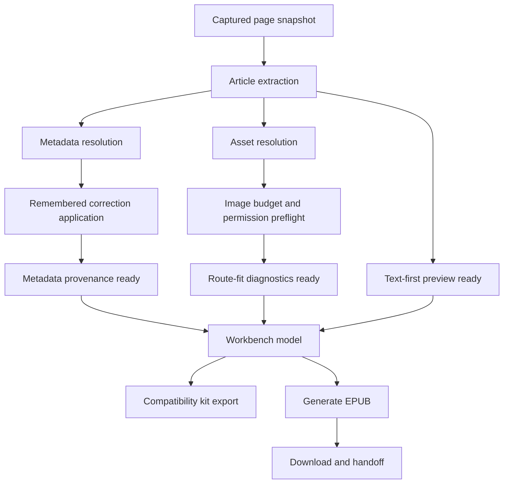
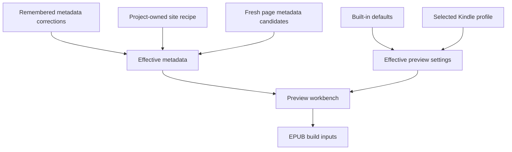

# feat: Add Obsidian-inspired preview confidence layer

## Summary

Evolve Article Ferry from a linear MVP converter into a faster, more inspectable Kindle preparation workbench. The plan borrows Obsidian Web Clipper's strongest transferable lessons - local/private operation, inspectable capture state, configurable repeat decisions, site-aware extraction, and portable debugging - while staying native to Article Ferry's Kindle EPUB and user-mediated delivery identity.

---

## Problem Frame

The MVP already has the core local-first conversion pipeline: active-tab snapshot, Readability extraction, metadata ranking, image budgeting, route diagnostics, EPUB build, download, Amazon web upload handoff, email handoff, and privacy-preserving local storage. The ideation document argues that Obsidian Web Clipper feels powerful because users can inspect and shape what will be saved before committing, but Article Ferry should not copy Obsidian's Markdown template model directly.

Article Ferry's equivalent power surface is confidence before Kindle handoff: capture mode clarity, metadata provenance, image/file-size tradeoffs, delivery route fit, remembered local corrections, site-specific extraction fixes, Kindle preview validation, and safe compatibility reporting. This plan covers the full staged set of ranked ideas from the ideation doc while explicitly deferring full template languages, AI interpreter behavior, Markdown export, cross-browser expansion, and multi-article queues.

---

## Requirements

### Explainable And Fast Preview

- R1. The side panel shows the current capture mode, extraction confidence, metadata provenance, image budget status, route-fit status, non-prompting permission preflight, and final EPUB filename before generation.
- R2. The preview renders a useful text-first result as soon as article extraction succeeds, then fills in metadata alternatives, asset decisions, route diagnostics, and non-prompting permission status progressively.
- R3. The preview pipeline records local timing marks for capture, extraction, metadata resolution, asset planning, permission planning, EPUB build, download, and delivery handoff without telemetry or remote reporting.
- R4. Preview controls remain usable in the narrow Chrome side panel without hiding the generate/handoff path or making warnings harder to act on.

### Repeatable Kindle Choices

- R5. Users can choose named Kindle profiles that bundle delivery route, image mode/budget posture, and filename convention without changing extraction or metadata values.
- R6. Built-in profiles include fast email, rich web upload, local EPUB only, and image-heavy article variants, with a conservative default that preserves the current MVP behavior.
- R7. User profile selection and local profile overrides are stored locally, validated on load, and recover safely to defaults when stored data is malformed.

### Local Site Learning

- R8. When users edit title, author, source, or publication date, Article Ferry can offer to remember a local correction rule for the current domain or URL pattern.
- R9. Remembered metadata correction rules apply before the preview is shown, are visible as provenance, and can be reviewed or deleted from a local settings surface.
- R10. Site recipes can override or supplement metadata and asset selection for known compatibility targets using a narrow, validated rule schema based on URL patterns, meta tags, schema.org data, and safe selectors.
- R11. V1 site recipes are project-owned and fixture-backed for the existing hard targets before any import/export or user-authored recipe surface is added.

### Trust, Portability, And Reader Validation

- R12. Users can export a sanitized compatibility kit containing conversion report data, metadata candidate summaries, image decision summaries, extension version, and optional recipe hints without article body content, sensitive user-entered metadata, Kindle email details, or full private URLs unless explicitly approved in a local preview.
- R13. Kindle preview validation controls help users validate the reading experience before upload, including extraction-stage indicators and lightweight checks that map to EPUB confidence.
- R14. The plan preserves the existing no-backend, no-telemetry, no-Amazon-credential-automation, no-private-endpoint posture.

---

## Key Technical Decisions

- KTD1. Extend the existing preview pipeline instead of replacing it: `buildPreviewFromSnapshot`, `PreviewModel`, `ConversionReport`, and the current side-panel components already expose most of the workbench inputs. The plan should add state shape, provenance, progressive readiness, and UI grouping around those patterns rather than introducing a parallel conversion engine.
- KTD2. Keep Obsidian-style configurability domain-native: Obsidian templates organize Markdown output into vault destinations, while Article Ferry profiles should organize Kindle route, image budget, and filename conventions. Metadata changes belong to remembered corrections or site recipes because those can expose provenance; a general template language is deferred because it would add complexity outside the EPUB delivery job.
- KTD3. Make progressive preview a state contract, not just UI polish: the text preview should be available after extraction even if asset planning, non-prompting permission preflight, or route diagnostics are still pending. This requires explicit preview stages, local performance marks, a run id keyed by snapshot/effective options, and stale-update rejection so partial states do not look like broken or contradictory states.
- KTD4. Store user learning as small validated local records: profiles, remembered metadata corrections, and future recipe settings should follow the existing `chrome.storage.local` pattern, cap or validate retained data, and avoid article bodies, sync storage, raw query strings, and broad reading history. Each storage surface needs a data inventory row before implementation.
- KTD5. Keep site recipes narrow and project-owned first: Obsidian's URL/schema.org triggers prove the value of site-aware extraction, but Article Ferry should start with internal TypeScript constants and fixtures for FS.blog and Wolfram rather than exposing user-authored selectors, import parsers, variables, transforms, loops, or UI authoring.
- KTD6. Compatibility kit export is a sanitized diagnostic, not telemetry: the export should be user-initiated, local, inspectable before download, and field-allowlisted. Redaction should reuse the existing conversion-report hostname posture and add tests for private URL/query/body leakage plus sensitive metadata handling.
- KTD7. Kindle preview validation remains a preview aid, not a second product mode: controls should help users assess EPUB output confidence before generation, but output correctness and route fit remain the primary success criteria.
- KTD8. Permission preflight is non-prompting in preview: Chrome optional permissions are requested from user gestures, so preview should use `planAssetPermissions` plus `chrome.permissions.contains()` to show current grant status and "will request on Generate" messaging. `chrome.permissions.request()` stays inside explicit generate/export click handlers, and v1 should revoke optional host grants after conversion rather than remembering them.

---

## High-Level Technical Design

### Progressive Preview Pipeline

The existing synchronous preview builder can remain the implementation starting point, but the plan should introduce stage-aware state so Article Ferry can show text first and fill diagnostic panels progressively as each local stage completes.

### Local Configuration Layers

Defaults should always be recoverable. Profiles affect user choices around route/image/file naming; remembered corrections and site recipes affect metadata/asset interpretation. Keeping those layers separate prevents a "profile" from becoming a hidden extraction recipe.

---

## Workbench Contracts

### Default Path Contract

The first view should stay conversion-first: readable preview, title/author, route status, filename preview, and one generate/handoff action are visible without opening advanced panels. Provenance, timing marks, recipe details, compatibility kit export, and lower-priority diagnostics are collapsed behind details unless they are blocking, warning, or explicitly opened by the user.

### Side Panel IA Contract

The side panel should keep a persistent top status strip, a scrollable preview/workbench body, and a fixed delivery action area. Inside the scrollable body, default ordering is metadata summary, route/profile controls, blocking/warning diagnostics, article preview, then collapsed details. Settings open as a separate panel state with an explicit back/dismiss path and focus return to the invoking control.

### Progressive State Matrix

| Stage | Ready State | Pending / Stale State | Error / Blocked State | Invalidated By |
| --- | --- | --- | --- | --- |
| Capture | Snapshot available | Capture loading | Capture access denied or no readable tab | New capture request |
| Extraction | Text-first preview available | Extraction loading | Empty/readability failed | New snapshot |
| Metadata | Candidates and remembered-rule provenance available | Metadata resolving or stale | Candidate parser failed with fallback metadata | New snapshot, rule changes |
| Asset plan | Image decisions estimated | Recalculating | Unsupported/unsafe assets summarized | New snapshot, profile/image-mode changes |
| Permission preflight | Current grant status known through non-prompting check | Checking `chrome.permissions.contains()` | Missing origins shown as "will request on Generate" | Asset plan changes, host grants removed |
| Route diagnostics | Route fit and filename ready | Recalculating | Selected route blocked by estimated size or missing required settings | Profile, route, image mode, metadata edits |
| Generation | Downloaded file and handoff status ready | Generating/downloading | Build/download/handoff failed | User retry, profile/metadata/image changes |

Every async or deferred stage commit should carry a preview run id/version keyed by snapshot plus effective route, image mode, profile, and rule versions. Stale commits are discarded rather than merged into the current preview.

### Storage Inventory Contract

| Surface | Storage Area | Sensitivity | Retention | Clear / Reset Behavior |
| --- | --- | --- | --- | --- |
| User settings and selected profile | `chrome.storage.local` | Kindle email can be sensitive | Until user clears | Clear restores defaults and removes Kindle email |
| Local profile overrides | `chrome.storage.local` | Low unless filename convention includes user text | Validated on load, no sync | Reset removes overrides and falls back to built-ins |
| Remembered metadata rules | `chrome.storage.local` | May reveal site plus user-entered metadata | Capped list, no article body, no query strings | Delete individual rules or clear all |
| Latest snapshot/session state | Existing local session storage path | May include page HTML | Current preview/session only | Replaced by capture, cleared with local history controls if exposed |
| Timing marks | In-memory or current preview state | Low if stage-only | Current preview/export only | Not persisted beyond preview unless included in compatibility kit |
| Optional host grants | Chrome permissions API | Grants host access | V1 revokes after conversion | No remembered grants in v1; if later remembered, settings must expose revoke |

Each row needs a parser/validator test or a clear reason no persisted schema exists. `chrome.storage.sync` remains out of scope for every row.

### Compatibility Kit Field Contract

The compatibility kit should be generated from an allowlist and previewed as JSON before download. Safe-by-default fields include extension version, snapshot mode, redacted hosts, warning codes, image decision counts, stage timings, selected built-in profile id, and recipe ids when present. Sensitive fields such as title, author, user-entered metadata, Kindle email, full URLs, selected text, article body, raw image URLs, and recipe stubs are omitted, summarized, or included only after an explicit local approval in the export UI.

### Recipe Lifecycle

Compatibility learning should flow from compatibility kit to issue report, then to a sanitized fixture, then to an internal project-owned recipe, then to a smoke test. This keeps user-authored recipes deferred while making site learning operational beyond the two initial hard targets.

---

## Scope Boundaries

### In Scope

- Full staged coverage of the seven ranked ideas in the ideation document.
- Built-in and locally stored delivery profiles.
- Local remembered metadata corrections using the existing metadata edit rule foundation.
- Project-owned site recipes for known compatibility targets.
- Sanitized compatibility kit export.
- Kindle preview validation and extraction-stage visibility.
- Local performance marks and side-panel-visible timing diagnostics.

### Deferred to Follow-Up Work

- User-authored recipe import/export and recipe marketplace/directory behavior.
- Recipe editor UI, recipe variables, transforms, loops, and user-authored selector logic.
- Full Obsidian-style template language, filters, loops, and variable authoring.
- Optional AI Interpreter or external model provider integration.
- Cross-browser release work beyond preserving implementation choices that do not make it harder later.
- Markdown export, capture queues, multi-article EPUBs, and domain-level local dashboards.
- Reading-history views, domain dashboards, and generalized privacy/history management outside the persistence introduced by this plan.
- Switching extraction engines away from Readability.

### Outside This Product's Identity

- Amazon credential storage or Amazon login automation.
- Calling private Amazon delivery endpoints.
- Backend processing, telemetry, remote diagnostic upload, or cloud sync for article data.

---

## Phased Delivery

### Phase 1. Confidence Workbench Foundation

Land U1, U2, and U9 first so the existing preview flow gains explicit readiness stages, local timing marks, the inspectable workbench shell, and browser-level layout/a11y verification without changing stored user preferences or extraction semantics. This phase should preserve current Wolfram and FS.blog compatibility behavior while making partial preview states visible.

### Phase 2. Repeatable Local Decisions

Land U3 and U4 after the workbench foundation so profiles and remembered metadata corrections have clear UI placement, provenance labels, and local storage management. This phase turns repeated user choices into validated local records while keeping defaults recoverable.

### Phase 3. Compatibility Learning And Trust

Land U6 once the workbench has safe diagnostic inputs; include profile and recipe fields opportunistically when U3/U5 exist. Land U5 as the project-owned recipe layer that feeds the support loop from compatibility kit to fixture to recipe to smoke test.

### Phase 4. Kindle Preview Validation And Persistence Management

Land U7 and U8 last so Kindle preview validation and settings management sit on top of the settled workbench, profile, rule, and export surfaces rather than shifting underneath earlier work.

---

## Implementation Units

### U1. Preview Stage Model And Local Timing Marks

**Goal:** Add explicit preview stages, stage-level diagnostics, non-prompting permission preflight, stale-result protection, and local timing marks so the UI can show text-first readiness before slower diagnostics finish.

**Requirements:** R1, R2, R3, R14

**Dependencies:** None

**Files:**

- `src/types.ts`
- `src/ui/state/conversionStore.ts`
- `src/extraction/permissionPlanner.ts`
- `entrypoints/sidepanel/App.tsx`
- `tests/extraction/permissionPlanner.test.ts`
- `tests/manifest/permissions.test.ts`
- `tests/e2e/preview.spec.ts`
- `tests/e2e/compatibility-smoke.spec.ts`

**Approach:** Extend `PreviewModel` or introduce an adjacent workbench model that can represent extraction-ready, metadata-ready, asset-plan-ready, permission-preflight-ready, route-ready, and generated states. Add a local timing record that can be displayed or exported but never transmitted. Add a preview run id/version keyed by snapshot plus effective route, image mode, profile, and rule versions; every async or deferred stage commit must discard stale results. Preview permission preflight is non-prompting only: calculate required origins, check current grants with `chrome.permissions.contains()`, and show missing origins as "will request on Generate." Keep `chrome.permissions.request()` inside explicit generate/export user actions. Keep the current `buildPreviewFromSnapshot` behavior available as the compatibility path while adding stage-aware composition for the side panel.

**Execution note:** Start with characterization tests for the existing preview model so the progressive state work does not regress Wolfram and FS.blog smoke behavior.

**Patterns to follow:** `buildPreviewFromSnapshot` as the current orchestration point; `ConversionReport` warning severities; existing e2e snapshot fixtures.

**Test scenarios:**

- Happy path: an ordinary article snapshot reaches text preview state before asset diagnostics are marked complete.
- Covers AE1. Compatibility path: Wolfram and FS.blog fixtures still produce the same author/source/date outcomes after the preview model is staged.
- Timing path: capture, extraction, metadata, asset planning, permission preflight, route diagnostics, generation, download, and delivery handoff marks are recorded locally with monotonic or ISO timestamps suitable for display.
- Stale path: rapid capture refreshes or route/image/profile/rule changes while stages are pending discard older stage results instead of merging stale metadata, asset, permission, or route diagnostics.
- Permission path: preview preflight checks optional host permission status without calling `chrome.permissions.request()`, and manifest tests continue to reject static broad host access.
- Error path: extraction failure produces a failed extraction stage and does not fabricate metadata, image, or route-ready states.
- Privacy path: timing diagnostics contain stage names and durations only, not article body content or full private URLs.

**Verification:** The preview model can represent partial readiness, existing fixture expectations still pass, and timing diagnostics are visible to UI/export code without adding any remote reporting surface.

### U2. Explainable Preview Workbench UI

**Goal:** Reorganize the side panel into a conversion-first workbench shell that surfaces the default path and keeps advanced diagnostics available without making the first view feel like a console.

**Requirements:** R1, R2, R4

**Dependencies:** U1

**Files:**

- `entrypoints/sidepanel/App.tsx`
- `entrypoints/sidepanel/style.css`
- `src/ui/components/ArticlePreview.tsx`
- `src/ui/components/ConversionReport.tsx`
- `src/ui/components/MetadataEditor.tsx`
- `src/ui/components/DeliveryPanel.tsx`
- `src/ui/components/ImageModeControl.tsx`
- `src/ui/components/PreviewWorkbench.tsx`
- `tests/ui/conversionReport.test.tsx`
- `tests/ui/metadataEditor.test.tsx`
- `tests/ui/deliveryPanel.test.tsx`
- `tests/e2e/preview.spec.ts`

**Approach:** Add a workbench component that composes existing controls into scan-friendly sections rather than expanding the page with explanatory copy. The default path shows readable preview, title/author, route status, filename preview, and one generate/handoff action. Provenance, timing, recipe details, compatibility kit export, and low-priority diagnostics stay collapsed unless blocking, warning, or explicitly opened. Metadata fields should show candidate source/confidence in a compact way; the report should separate route blockers from image notices; the delivery panel should show the predicted filename before generation. Maintain a stable fixed handoff area while allowing the preview itself to scroll.

**Patterns to follow:** Current side-panel CSS constraints, `MetadataEditor` candidate alternatives, `ConversionReport` severity rendering, `DeliveryPanel` fixed bottom action pattern.

**Test scenarios:**

- Covers AE1. Happy path: when a preview is ready, the panel shows capture mode, metadata provenance, route fit, image counts, estimated size, and filename preview.
- Partial state: while asset diagnostics are pending, the text preview remains visible and route/image sections show pending state rather than stale final values.
- Warning path: route-limit blocking warnings appear above lower-priority image notices and retain their action text.
- First-time path: a clean ordinary article can be captured, reviewed, generated, and handed off without opening advanced details, settings, timing marks, recipe details, or compatibility kit export.
- Accessibility path: form fields and major regions have stable accessible names after the workbench shell reorganization.

**Verification:** Component and e2e tests prove the workbench renders complete and partial preview states while preserving the default conversion path.

### U3. Kindle Delivery Profiles

**Goal:** Add named Kindle profiles that bundle route, image mode, and file naming posture without becoming a general template language or hidden metadata layer.

**Requirements:** R5, R6, R7, R14

**Dependencies:** U1, U2

**Files:**

- `src/types.ts`
- `src/storage/settings.ts`
- `src/storage/kindleProfiles.ts`
- `src/ebook/epubBuilder.ts`
- `src/ebook/imageBudget.ts`
- `src/ui/components/ProfileSelector.tsx`
- `src/ui/components/ImageModeControl.tsx`
- `src/ui/components/DeliveryPanel.tsx`
- `tests/storage/settings.test.ts`
- `tests/storage/kindleProfiles.test.ts`
- `tests/ebook/epubBuilder.test.ts`
- `tests/ebook/imageBudget.test.ts`
- `tests/ui/profileSelector.test.tsx`
- `tests/ui/deliveryPanel.test.tsx`

**Approach:** Define built-in profiles as data, then persist only the selected profile and validated local overrides. V1 does not support free-form custom profile creation; it supports built-in profiles plus constrained overrides where the UI explicitly exposes them. Profiles should select existing `DeliveryRoute` and `ImageMode` values first, with any new image-heavy posture introduced only if tests show the current `smart-images` cap cannot express it safely. Filename conventions should remain constrained tokens derived from already-sanitized metadata rather than free-form templates. Metadata defaults are out of profile scope for v1; remembered corrections and recipes own metadata changes because they can show provenance.

**Patterns to follow:** `defaultSettings`, `loadSettings` validation/fallback behavior, `buildFileName`, `ROUTE_LIMITS`, existing Kindle email validation.

**Test scenarios:**

- Happy path: selecting fast email sets email handoff plus conservative image behavior and preserves a valid Kindle email if present.
- Happy path: selecting rich web upload uses the web-upload route and a richer image posture while still respecting route budgets.
- Local-only path: local EPUB only profile generates a text-first Kindle-compatible EPUB posture and filename preview without implying a generic archive/read-it-later workflow.
- Covers AE3. Large-article path: selecting fast email for an image-heavy article recalculates route diagnostics before generation and warns when email limits are likely to be exceeded.
- Image-heavy path: image-heavy article profile is explicitly defined or intentionally aliases rich web upload with a test proving the chosen image posture and route budget behavior.
- Validation path: malformed stored profile data falls back to built-in defaults without throwing.
- Filename path: profile filename convention uses sanitized metadata and never includes slashes, query strings, or blank titles.
- Integration path: changing profile updates route diagnostics and generated filename preview before EPUB generation.

**Verification:** Users can switch between built-in profiles, refresh the side panel, and see validated settings restored with route/image diagnostics recalculated.

### U4. Remembered Metadata Corrections

**Goal:** Connect the existing metadata edit-rule storage to the preview flow so users can save, apply, and provenance-tag local corrections; settings UI owns later review/delete management.

**Requirements:** R8, R9, R14

**Dependencies:** U1, U2

**Files:**

- `src/storage/recentMetadataEdits.ts`
- `src/extraction/metadataResolver.ts`
- `src/ui/state/conversionStore.ts`
- `src/ui/components/MetadataEditor.tsx`
- `tests/storage/userSettings.test.ts`
- `tests/extraction/metadataResolver.test.ts`
- `tests/e2e/preview.spec.ts`
- `tests/ui/metadataEditor.test.tsx`

**Approach:** Expand `MetadataEditRule` matching beyond the current site/field/value record only as far as v1 needs: `http`/`https` host plus normalized path prefix, field allowlist, max value lengths, and control-character rejection. Do not support regex, selectors, scripts, broad wildcards, or cross-domain matching. Apply remembered rules as provenance-tagged candidates or selected values before rendering the editor, and show a trust-preserving interaction flow after a user changes a supported field: edit field, offer row appears, choose domain or URL-prefix scope, remember or not now, then show saved provenance with an undo affordance for the current action. Stored values must be safely escaped anywhere they appear in preview or EPUB metadata. U8 owns the review/delete management surface.

**Patterns to follow:** Existing `saveMetadataEditRule`, `loadMetadataEditRules`, `clearMetadataEditRules`, `metadataWithEdits`, candidate source display, local storage tests with mocked `chrome.storage.local`.

**Test scenarios:**

- Covers AE2. Happy path: editing FS.blog author to a remembered value offers to save a domain-scoped rule and applies it on the next FS.blog preview.
- Provenance path: remembered corrections are labeled as local remembered rules and remain distinguishable from JSON-LD, citation metadata, and DOM candidates.
- Scope path: a correction for one domain does not apply to a different domain with the same field value.
- Conflict path: if fresh high-confidence page metadata conflicts with a remembered rule, the editor exposes both candidates rather than silently hiding the conflict.
- Interaction path: choosing not now dismisses the offer for the current edit without saving a rule, and saving a rule exposes current-action undo without requiring the settings panel.
- Privacy path: stored rules contain normalized site/pattern, field, value, and timestamp only, not article body content or full query-bearing URLs.
- Safety path: invalid rule patterns, control characters, selectors, scripts, broad wildcards, and cross-domain matches are rejected or ignored by validation.

**Verification:** Remembered corrections apply predictably, expose provenance, and do not leak reading history beyond the constrained rule record.

### U5. Project-Owned Site Recipes For Hard Targets

**Goal:** Add a narrow, validated recipe layer for known compatibility targets such as FS.blog and Wolfram, covering metadata and asset hints without opening user-authored selector power yet.

**Requirements:** R10, R11, R14

**Dependencies:** U1, U4

**Files:**

- `src/extraction/siteRecipes.ts`
- `src/extraction/metadataResolver.ts`
- `src/extraction/assetResolver.ts`
- `src/extraction/metadataSources.ts`
- `tests/extraction/siteRecipes.test.ts`
- `tests/extraction/metadataResolver.test.ts`
- `tests/extraction/assetResolver.test.ts`
- `tests/e2e/compatibility-smoke.spec.ts`
- `tests/fixtures/articles/wolfram-shape.html`
- `tests/fixtures/articles/fsblog-shape.html`

**Approach:** Define v1 recipes as internal TypeScript constants only. The schema can include URL matching, optional schema.org/meta extraction hints, allow-listed safe selector hints, and asset include/exclude hints, but must not include an import parser, UI editor, variables, transforms, loops, arbitrary regex replacement, or user-authored selector logic. Apply recipe hints as another provenance source in metadata/asset resolution while preserving normal extraction fallbacks. Tie the support loop to U6: compatibility kit, issue report, sanitized fixture, project-owned recipe, smoke test.

**Execution note:** Treat FS.blog and Wolfram fixtures as characterization coverage before adding recipe behavior.

**Patterns to follow:** Current metadata candidate scoring, `AssetCandidate` and `ResolvedAsset` flow, compatibility smoke tests, Obsidian's URL/schema.org trigger lesson translated into a constrained local schema.

**Test scenarios:**

- Wolfram recipe path: the target fixture still resolves Stephen Wolfram and the publication date while recipe hints improve or preserve asset decisions.
- FS.blog recipe path: the target fixture keeps Charlie Munger as reader-facing author and Farnam Street as source.
- URL matching path: recipes match only intended host/path patterns and do not apply to unrelated pages on the same broad web.
- Selector safety path: unsupported selector shapes or attributes are rejected by recipe validation.
- Boundary path: recipes cannot be loaded from user JSON, edited in UI, or express variables/transforms/loops.
- Lifecycle path: adding a new recipe starts from a sanitized fixture and ends with a compatibility smoke test that names the supported site.
- Fallback path: when a recipe hint produces no value, normal metadata and asset extraction still run.
- Provenance path: values influenced by recipes are visible in metadata or diagnostics as recipe-derived rather than hidden magic.

**Verification:** Recipe-backed compatibility targets pass smoke tests, invalid recipes fail validation in tests, and unrelated fixtures keep the baseline extractor behavior.

### U6. Sanitized Compatibility Kit Export

**Goal:** Let users export a local compatibility kit that helps debug extraction and Kindle route issues without including article bodies, private URLs, sensitive metadata values, or sensitive query strings by default.

**Requirements:** R12, R14

**Dependencies:** U1, U2

**Files:**

- `src/diagnostics/conversionReport.ts`
- `src/diagnostics/compatibilityKit.ts`
- `src/diagnostics/compatibilityHints.ts`
- `src/delivery/downloadArticle.ts`
- `src/ui/components/ConversionReport.tsx`
- `src/ui/components/CompatibilityExportButton.tsx`
- `README.md`
- `docs/privacy.md`
- `tests/diagnostics/conversionReport.test.ts`
- `tests/diagnostics/compatibilityHints.test.ts`
- `tests/diagnostics/compatibilityKit.test.ts`
- `tests/ui/conversionReport.test.tsx`

**Approach:** Build a JSON export from an explicit allowlist of diagnostic inputs: extension version, snapshot mode, redacted source host, canonical host, metadata candidate source/confidence summaries, conversion warnings, image decision counts and hostnames, timing marks, and route/image settings. Include selected profile id when U3 has landed and recipe identifiers when U5 has landed; otherwise omit those optional fields. Sensitive values such as title, author, user-entered metadata, Kindle email, full URLs, selected text, article body, raw image URLs, and recipe stubs are omitted, summarized, or included only after explicit local approval in a JSON preview before download. The export is available from preview diagnostics before generation and may include generated-file status after generation.

**Patterns to follow:** `redactedHost`, conversion report warning codes, download handoff helpers, README compatibility-report guidance, privacy docs.

**Test scenarios:**

- Happy path: export contains conversion report, metadata candidate summary, image decision summary, extension version, timing marks, route/image settings, and optional profile/recipe identifiers when those units have landed.
- Covers AE4. Redaction path: export omits article HTML, text content, selected text, private title/author values, user-entered metadata, Kindle email, image query strings, URL fragments, and full private URLs unless explicitly approved in the local JSON preview.
- Preview path: user can inspect the exact JSON payload before download and cancel without changing preview state.
- Host path: URL-bearing fields are reduced to safe host or origin-level summaries unless the URL is explicitly public and sanitized by policy.
- Failure path: if export download fails, the UI shows a recoverable error and leaves preview state intact.
- Regression path: conversion report redaction tests still prove skipped-image messages exclude secret query strings.

**Verification:** A generated bundle is useful for filing a compatibility report and tests prove it does not contain article body content or query-bearing URLs.

### U7. Kindle Preview Validation Controls

**Goal:** Make the preview a place users can validate Kindle output confidence before upload by adding lightweight validation controls and extraction-stage indicators.

**Requirements:** R13, R4, R14

**Dependencies:** U1, U2

**Files:**

- `src/ui/components/ArticlePreview.tsx`
- `src/ui/components/ReaderPreviewControls.tsx`
- `entrypoints/sidepanel/style.css`
- `tests/ui/articlePreview.test.tsx`
- `tests/ui/readerPreviewControls.test.tsx`
- `tests/e2e/preview.spec.ts`
- `tests/playwright/sidepanel-workbench.spec.ts`

**Approach:** Add compact controls for Kindle validation rather than cosmetic reading preferences. Preview-only controls live in a separate "Preview view" group from "EPUB settings" and do not change generated output unless the user changes actual image/profile controls. Limit v1 controls to checks that map to EPUB confidence, such as text density preview, generated-image visibility preview, overflow/long-title visibility, and extraction-stage status. The preview should help users answer "will this read well on Kindle?" while preserving Generate EPUB and route warnings as the main workflow.

**Patterns to follow:** Current `ArticlePreview` sanitized HTML rendering, side-panel CSS, image mode control semantics.

**Test scenarios:**

- Happy path: preview controls change the side-panel reading view without changing EPUB build inputs unless the user changes the actual image/profile controls.
- Stage path: extraction, metadata, image planning, and route diagnostics stages are visible in the preview workbench.
- Image visibility path: users can preview text-focused reading without losing the underlying image budget decisions.
- Narrow layout: controls fit in the side panel without overlapping article content or the fixed delivery panel.
- Accessibility path: Kindle preview controls expose labels and selected states to assistive technologies.

**Verification:** Users can adjust preview readability and inspect stage status while keeping the generated EPUB behavior tied to explicit delivery/image/profile settings.

### U8. Local Settings Surface For Profiles, Rules, And Persistence Controls

**Goal:** Provide a small settings/review surface for stored profiles, remembered metadata rules, and persistence controls introduced by this plan.

**Requirements:** R7, R9, R14

**Dependencies:** U3, U4, U6

**Files:**

- `entrypoints/sidepanel/App.tsx`
- `src/storage/settings.ts`
- `src/storage/kindleProfiles.ts`
- `src/storage/recentMetadataEdits.ts`
- `src/ui/components/SettingsPanel.tsx`
- `src/ui/components/ProfileSelector.tsx`
- `src/ui/components/MetadataRulesPanel.tsx`
- `docs/privacy.md`
- `tests/storage/settings.test.ts`
- `tests/storage/kindleProfiles.test.ts`
- `tests/storage/userSettings.test.ts`
- `tests/ui/settingsPanel.test.tsx`
- `tests/ui/metadataRulesPanel.test.tsx`

**Approach:** Add a constrained settings surface inside the side panel rather than a separate options page unless implementation proves side-panel space inadequate. Settings open as a separate panel state with a visible back/dismiss control, focus return to the invoking control, empty states for no rules/no overrides, and confirmation before destructive clears. Users should be able to pick/reset profiles, inspect/delete remembered metadata rules, and clear persistence introduced by this plan. Keep compatibility-kit privacy copy in U6, and keep reading-history views, domain dashboards, recipe editor UI, and broad privacy/history management out of U8. V1 should not remember optional host grants; if implementation introduces remembered grants later, this unit must expose grant revocation and tests.

**Patterns to follow:** Existing `clearSettings`, `clearMetadataEditRules`, local storage validation tests, compact side-panel layout.

**Test scenarios:**

- Happy path: settings panel shows current selected profile and remembered metadata rules.
- Reset path: clearing profile/settings data restores defaults and recalculates preview diagnostics.
- Rule management path: deleting a metadata rule removes it from storage and updates the current preview if applicable.
- Persistence path: clearing plan-owned persistence removes profile overrides, remembered rules, and Kindle email while leaving no sync-storage calls.
- Covers AE5. Validation path: malformed profile or metadata-rule records recover to defaults and keep the side panel usable.
- Destructive-action path: clearing settings or rules requires confirmation, handles empty states, returns focus after dismiss, and recalculates the current preview if affected.
- Layout path: settings panel can be opened and dismissed without losing current preview state.

**Verification:** Users can manage all new local persistence introduced by the plan from one visible place, and tests prove clear/reset actions use local storage only.

### U9. Workbench Layout, Visual, And Accessibility Hardening

**Goal:** Verify the dense workbench behaves professionally in real browser layout and assistive interaction states before reader/settings polish lands.

**Requirements:** R1, R2, R4, R13

**Dependencies:** U2

**Files:**

- `entrypoints/sidepanel/style.css`
- `src/ui/components/PreviewWorkbench.tsx`
- `src/ui/components/ConversionReport.tsx`
- `src/ui/components/DeliveryPanel.tsx`
- `tests/playwright/sidepanel-workbench.spec.ts`
- `tests/ui/conversionReport.test.tsx`
- `tests/ui/deliveryPanel.test.tsx`

**Approach:** Add browser-level side-panel coverage rather than relying only on jsdom/component tests. Load the built sidepanel or a representative harness with preview states at 320px and 480px widths. Cover loading, partial, warning, settings entry, export error, long filename, long metadata, keyboard tab order, focus return, fixed delivery actions, and `aria-live` stage updates. This unit hardens the visual/a11y surface created by U2; it does not add new product controls.

**Patterns to follow:** Existing Playwright configuration under `tests/playwright`, current side-panel CSS, fixed `DeliveryPanel` action pattern, workbench IA contract.

**Test scenarios:**

- Narrow layout: at 320px and 480px widths, metadata inputs, route controls, warning rows, collapsed details, article preview, and fixed delivery actions do not overlap or hide primary actions.
- Long content path: long filenames, long titles, long authors, and many warnings wrap or collapse without layout shift that blocks Generate EPUB.
- Keyboard path: tab order reaches capture, metadata fields, profile/route controls, details toggles, settings, export, and generate actions in a predictable order.
- Focus path: opening and dismissing settings/details restores focus to the invoking control.
- Live-region path: loading, partial, warning, done, and error stage changes announce through existing or new `aria-live` regions without double-announcing static content.

**Verification:** Browser-level tests or screenshots prove the workbench is non-overlapping and keyboard navigable in narrow side-panel dimensions.

---

## Acceptance Examples

- AE1. Given a Wolfram fixture preview, when the panel opens, then the user sees readable text quickly, Stephen Wolfram metadata provenance, image host/budget diagnostics, route fit, and an EPUB filename preview before generating.
- AE2. Given an FS.blog preview where the user edits author metadata, when the user chooses to remember the correction, then a later FS.blog preview applies the local correction with visible remembered-rule provenance and allows deletion.
- AE3. Given the fast email profile, when the selected article has many images, then route diagnostics favor a conservative image posture and warn before email limits are likely to be exceeded.
- AE4. Given a compatibility issue, when the user exports a compatibility kit, then the downloaded JSON contains report/candidate/decision summaries and omits article body content, selected text, query strings, and fragments.
- AE5. Given a malformed profile or metadata-rule record in local storage, when the side panel loads, then Article Ferry falls back to defaults and keeps the preview usable.
- AE6. Given a clean ordinary article, when a first-time user opens the side panel, then they can review the readable preview, title/author, route status, filename, and generate action without opening advanced details.
- AE7. Given an image-heavy article with cross-origin assets, when the preview workbench runs permission preflight, then it checks current grants without prompting and only requests optional host access after an explicit Generate or export action.

---

## System-Wide Impact

- **Preview state:** The side panel moves from a mostly synchronous preview model to staged readiness. Implementers should expect explicit state transitions, run identity, stale-result rejection, partial-state tests, and browser-level layout checks.
- **Storage schema:** Profiles and remembered correction rules expand local persistence. Every stored record needs parsing, validation, fallback, clear/delete behavior, privacy review, and an entry in the storage inventory.
- **Extraction semantics:** Site recipes add a new provenance layer to metadata and asset decisions. Tests must prove recipes improve hard targets without weakening generic pages.
- **Permission posture:** Preview preflight becomes non-prompting; optional host permission prompts stay tied to explicit user gestures, and v1 revokes grants after conversion.
- **Privacy posture:** Compatibility kit export and timing marks create new diagnostic surfaces. They must stay user-initiated, local, field-allowlisted, redacted, previewable, and documented.
- **UX density:** The side panel becomes more capable. Layout testing matters because Chrome side panels are narrow and the fixed delivery action remains workflow-critical.

---

## Risks & Dependencies

- **UI density risk:** The workbench can become crowded. Mitigate by using compact grouped controls, progressive disclosure for low-priority diagnostics, and narrow-width e2e checks.
- **Rule misapplication risk:** Remembered metadata rules can be wrong across sections of a domain. Mitigate with visible provenance, conflict surfacing, review/delete controls, and conservative domain/pattern matching.
- **Recipe overreach risk:** A recipe schema can accidentally become a general template language. Mitigate by keeping v1 project-owned, fixture-backed, and limited to metadata/asset hints.
- **Privacy regression risk:** Compatibility export could leak reading context. Mitigate with explicit redaction tests for article body, selected text, query strings, fragments, and raw image URLs.
- **Permission prompt risk:** Preview-time permission prompts would conflict with Chrome's user-gesture expectations. Mitigate by making preview preflight non-prompting and keeping permission requests inside explicit Generate/export actions.
- **Performance complexity risk:** Progressive preview may add async state bugs. Mitigate with stage-model tests and compatibility smoke tests before UI reorganization.

---

## Sources & Research

- `docs/ideation/2026-06-05-obsidian-web-clipper-lessons-ideation.md` is the origin source for the ranked ideas, rejection boundaries, and Article Ferry strategy translation.
- `docs/plans/2026-06-05-001-feat-kindle-article-extension-plan.md` establishes the completed MVP architecture and privacy/compliance constraints this plan must preserve.
- `entrypoints/sidepanel/App.tsx`, `src/ui/state/conversionStore.ts`, `src/types.ts`, `src/storage/recentMetadataEdits.ts`, `src/storage/settings.ts`, and `src/diagnostics/conversionReport.ts` show the current local-first pipeline, side-panel composition, storage model, and diagnostic redaction patterns.
- Obsidian Web Clipper documentation highlights local/private clipping, reader mode, templates, variables, URL/schema.org triggers, and optional Interpreter behavior: `https://obsidian.md/help/web-clipper`, `https://obsidian.md/help/web-clipper/templates`, `https://obsidian.md/help/web-clipper/variables`, and `https://obsidian.md/help/web-clipper/interpreter`.
- Obsidian Web Clipper's public README reinforces the durable local-output and auditable-code posture: `https://raw.githubusercontent.com/obsidianmd/obsidian-clipper/main/README.md`.
- Chrome's permissions API documentation states that optional permissions are requested at runtime so users can understand why they are needed, and that `permissions.request()` should run from a user gesture while current grants can be checked separately: `https://developer.chrome.com/docs/extensions/reference/api/permissions`.
